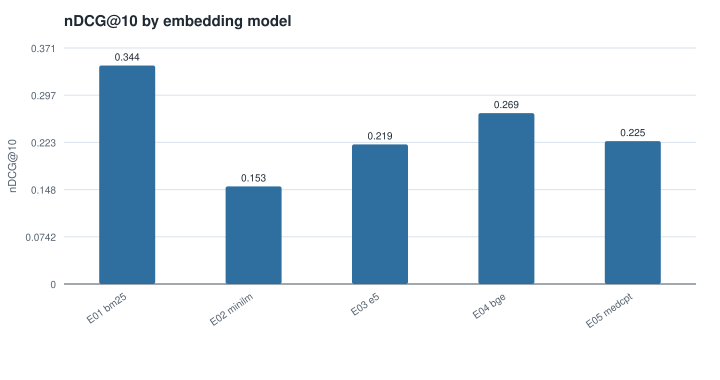
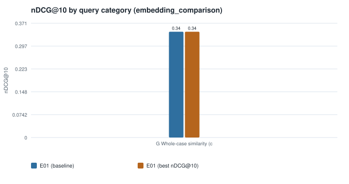
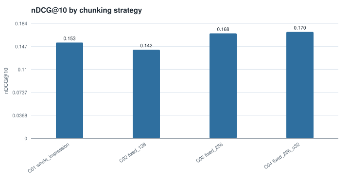
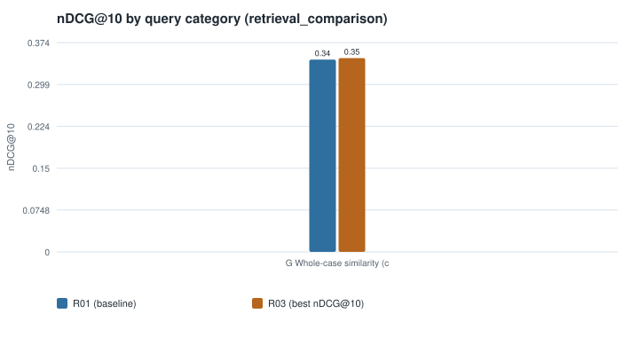
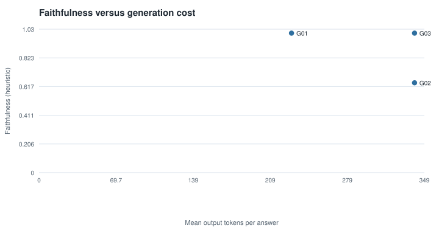
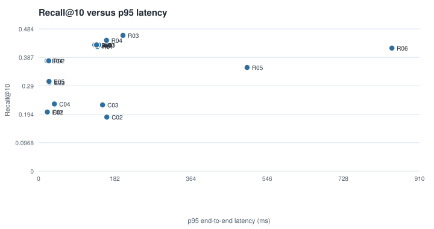
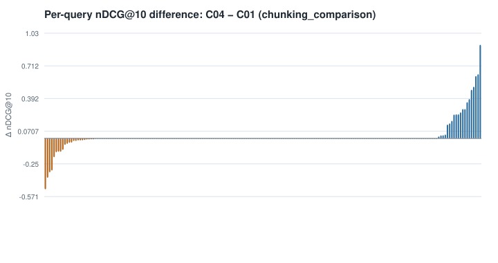
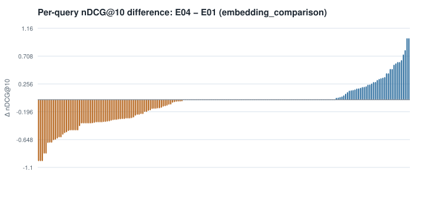
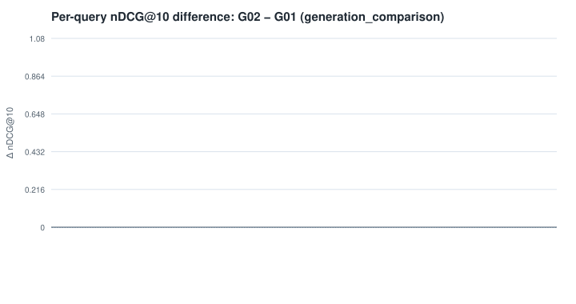
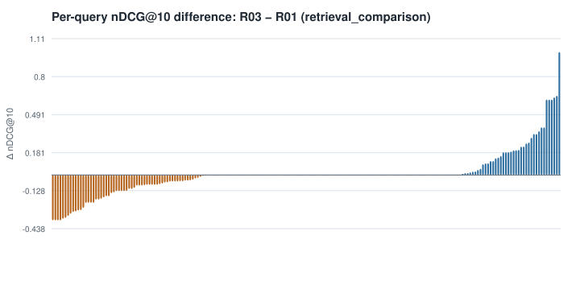

# INSPECT-RAG evaluation report

> **Dataset: PMC-Patients-ReCDS, patient-to-patient retrieval (PPR)** (licence: CC BY-NC-SA 4.0). PMC-Patients (published case-report summaries), not INSPECT. SUBSET of the benchmark: all judged-relevant patients of the sampled queries plus random distractors; results are not comparable with the full 155k-patient benchmark. Relevance labels come from the dataset's PubMed citation graph, not from clinician review. No dates, laboratory values or images; age and sex are parsed from the summary text. **No INSPECT experiment is reported here.**

> Source: Zhao Z, Jin Q, Chen F, Peng T, Yu S. A large-scale dataset of patient summaries for retrieval-based clinical decision support systems. Scientific Data 10, 909 (2023). <https://huggingface.co/datasets/zhengyun21/PMC-Patients-ReCDS>

> Research prototype. Not for diagnosis, treatment decisions or clinical use.

## 1. Dataset version and cohort characteristics

| Item | Value |
|---|---|
| Dataset | pmc_patients |
| Release | PMC-Patients-ReCDS PPR; subset written by prepare-dataset (see DATASET.json) |
| Adapter / schema | prepared / prepared-pmc-patients-1 |
| Fingerprint | 4a4c237e06adf06e6441e0a27e67c858b57b794e0e778ed6bd3a86c24d229f43 |
| Patients | 20400 |
| Cases | 20400 |
| Cases train / valid / test | 20000 / 200 / 200 |
| Patient summary records | 20400 |
| Clinical events | — |
| Imaging studies | 0 |
| Modalities | tabular |

## 2. Data cleaning and join validation

Joins use the dataset's own identifiers only; rejected rows are counted, never merged.

| Unmatched join | Rows |
|---|---|
| unmatched_cases_without_imaging | 0 |
| unmatched_cases_without_report | 0 |

_Not yet evaluated: no completed experiments for this section._

Warnings: no known research label columns found in cohort file; set dataset.columns.labels to ingest them; missing modality: EHR events (files.ehr_dir); missing modality: imaging (files.imaging_metadata/imaging_dir); PMC-Patients (published case-report summaries), not INSPECT. SUBSET of the benchmark: all judged-relevant patients of the sampled queries plus random distractors; results are not comparable with the full 155k-patient benchmark. Relevance labels come from the dataset's PubMed citation graph, not from clinician review. No dates, laboratory values or images; age and sex are parsed from the summary text.

## 3. Query-set composition

| Stage | Category | Queries |
|---|---|---|
| dev | G — Whole-case similarity (case to case) | 200 |
| test | G — Whole-case similarity (case to case) | 200 |

Query-set version `queries-8a6f739347934252`. Candidate corpus = training split; development queries = validation patients; final queries = held-out test patients. Query patients are excluded from their own results.

## 4. Relevance annotation methodology

Label sources used: `pmc_patients_ppr` (version `qrels-4773d052cdf1d2f8`); 0 rows from other label sources (e.g. weak labels) were excluded.

Graded case-level relevance: 3 highly, 2 moderately, 1 weakly, 0 not relevant; unjudged pairs are tracked separately (judged coverage is reported with every metric) and recall is judged-pool recall.

Labels are the published PMC-Patients patient-to-patient similarity annotations, which the dataset authors derived from the PubMed citation graph (binary in this split). They are not clinician judgments, and unlabelled pairs are counted as not relevant, so true similar patients without a citation link lower the scores.

## 5. Embedding comparison

| Experiment | Embedding | Retrieval | Fusion | Reranker | Modalities | Recall@10 | Precision@10 | nDCG@10 | p95 retrieval ms | Faithfulness | Index bytes | Status |
|---|---|---|---|---|---|---|---|---|---|---|---|---|
| E01 | — | bm25 | — | — | text | 0.4294 | 0.0855 | 0.3436 | 139.3859 | — | 65477639 | completed |
| E04 | bge | dense | — | — | text | 0.3753 | 0.0770 | 0.2688 | 17.6550 | — | 409307408 | completed |
| E05 | medcpt | dense | — | — | text | 0.3051 | 0.0640 | 0.2248 | 19.9092 | — | 409127842 | completed |
| E03 | e5 | dense | — | — | text | 0.3011 | 0.0660 | 0.2195 | 21.8540 | — | 408766365 | completed |
| E02 | minilm | dense | — | — | text | 0.2011 | 0.0410 | 0.1534 | 16.5832 | — | 261559716 | completed |

| Experiment | Model | Revision | Dim | Query-embed p95 ms | Vector-search p95 ms | Index build s (embedding) | Index bytes | Truncated documents | Queries truncated by the encoder |
|---|---|---|---|---|---|---|---|---|---|
| E01 | — | — | — | — | — | — | 65477639 | — | — |
| E02 | sentence-transformers/all-MiniLM-L6-v2 | 1110a243fdf4706b3f48f1d95db1a4f5529b4d41 | 384 | 2.1363 | 11.5461 | 62.6190 | 261559716 | 11573 | 0 |
| E03 | intfloat/e5-base-v2 | f52bf8ec8c7124536f0efb74aca902b2995e5bcd | 768 | 2.2271 | 16.4559 | 707.7269 | 408766365 | 12070 | 0 |
| E04 | BAAI/bge-base-en-v1.5 | a5beb1e3e68b9ab74eb54cfd186867f64f240e1a | 768 | 2.1025 | 12.6785 | 614.9311 | 409307408 | 12025 | 0 |
| E05 | ncbi/MedCPT-Article-Encoder | d05a736da4bb84ee4057b7f7999485be6ed85465 | 768 | 2.1932 | 16.0417 | 588.8705 | 409127842 | 9871 | 0 |

kNN is exact on the local backend and approximate (HNSW) on Elasticsearch; compare latency and recall only between runs on the same backend.

## 6. Chunking comparison

| Experiment | Embedding | Retrieval | Fusion | Reranker | Modalities | Recall@10 | Precision@10 | nDCG@10 | p95 retrieval ms | Faithfulness | Index bytes | Status |
|---|---|---|---|---|---|---|---|---|---|---|---|---|
| C04 | minilm | dense | — | — | text | 0.2286 | 0.0475 | 0.1705 | 22.9343 | — | 652845427 | completed |
| C03 | minilm | dense | — | — | text | 0.2254 | 0.0485 | 0.1682 | 143.1270 | — | 607241266 | completed |
| C01 | minilm | dense | — | — | text | 0.2011 | 0.0410 | 0.1534 | 18.0303 | — | 261559716 | completed |
| C02 | minilm | dense | — | — | text | 0.1840 | 0.0415 | 0.1419 | 148.8202 | — | 1054840549 | completed |

| Experiment | Chunking | Chunks | Avg tokens | Max tokens | % documents truncated | Embedding s | Index bytes | Recall@10 | nDCG@10 | p95 ms |
|---|---|---|---|---|---|---|---|---|---|---|
| C01 | whole_impression | 20400 | 653.0300 | 5757 | 88.9800 | 62.6190 | 261559716 | 0.2011 | 0.1534 | 21.7230 |
| C02 | fixed_128 | 114257 | 116.6000 | 128 | 0.0000 | 259.6190 | 1054840549 | 0.1840 | 0.1419 | 163.0832 |
| C03 | fixed_256 | 62627 | 212.7200 | 254 | 0.0000 | 222.3672 | 607241266 | 0.2254 | 0.1682 | 152.8850 |
| C04 | fixed_256_o32 | 67178 | 220.5900 | 254 | 0.0000 | 178.4851 | 652845427 | 0.2286 | 0.1705 | 37.8065 |

Texts shorter than the chunk limit are never split, so strategies whose limits exceed the text length produce identical chunk sets and therefore identical results.

## 7. Retrieval-method comparison

| Experiment | Embedding | Retrieval | Fusion | Reranker | Modalities | Recall@10 | Precision@10 | nDCG@10 | p95 retrieval ms | Faithfulness | Index bytes | Status |
|---|---|---|---|---|---|---|---|---|---|---|---|---|
| R03 | bge | bm25+dense | rrf | — | text | 0.4616 | 0.0940 | 0.3463 | 194.3563 | — | 474785047 | completed |
| R01 | — | bm25 | — | — | text | 0.4294 | 0.0855 | 0.3436 | 133.5177 | — | 65477639 | completed |
| R04 | bge | bm25+dense | weighted_score | — | text | 0.4450 | 0.0905 | 0.3427 | 155.1684 | — | 474785047 | completed |
| R06 | bge | bm25+dense | rrf | medcpt_cross_encoder | text | 0.4186 | 0.0860 | 0.3090 | 838.0347 | — | 474785047 | completed |
| R02 | bge | dense | — | — | text | 0.3753 | 0.0770 | 0.2688 | 20.1445 | — | 409307408 | completed |
| R05 | bge | bm25+dense | rrf | ms_marco_minilm | text | 0.3526 | 0.0735 | 0.2221 | 493.0725 | — | 474785047 | completed |

## 8. Reranking comparison

_Not yet evaluated: no completed experiments for this section._

## 9. Multimodal ablation

_Not yet evaluated: no completed experiments for this section._

## 10. RAG generation evaluation

| Experiment | Embedding | Retrieval | Fusion | Reranker | Modalities | Recall@10 | Precision@10 | nDCG@10 | p95 retrieval ms | Faithfulness | Index bytes | Status |
|---|---|---|---|---|---|---|---|---|---|---|---|---|
| G01 | — | bm25 | — | — | text | 0.4294 | 0.0855 | 0.3436 | 131.0483 | 1.0000 | 65477639 | completed |
| G02 | — | bm25 | — | — | text | 0.4294 | 0.0855 | 0.3436 | 130.3628 | 0.6440 | 65477639 | completed |
| G03 | — | bm25 | — | — | text | 0.4294 | 0.0855 | 0.3436 | 138.6791 | 1.0000 | 65477639 | completed |

| Experiment | Backend / model | Prompt | Verified | Relevance | Faithfulness | Citation correctness | Citation coverage | Citation relevance | Completeness | Abstention | Contradiction | Numeric accuracy | Parse failures | Latency ms | Output tokens |
|---|---|---|---|---|---|---|---|---|---|---|---|---|---|---|---|
| G01 | extractive / extractive-evidence-v1 | structured_citations | yes | 0.3333 | 1.0000 | 1.0000 | 1.0000 | 0.9222 | — | 1.0000 | 0.0000 | — | 0.0000 | 0.6672 | 228.3750 |
| G02 | ollama / llama3.2:1b | structured_citations | no | 0.6667 | 0.6440 | 1.0000 | 1.0000 | 1.0000 | — | 1.0000 | 0.0000 | — | 0.0000 | 61103.7520 | 339.6250 |
| G03 | ollama / llama3.2:1b | structured_citations | yes | 0.6667 | 1.0000 | 1.0000 | 1.0000 | 1.0000 | — | 1.0000 | 0.0000 | — | 0.0000 | 51939.3575 | 339.6250 |

## Main comparison table (all completed and attempted experiments)

| Experiment | Embedding | Retrieval | Fusion | Reranker | Modalities | Recall@10 | Precision@10 | nDCG@10 | p95 retrieval ms | Faithfulness | Index bytes | Status |
|---|---|---|---|---|---|---|---|---|---|---|---|---|
| C04 | minilm | dense | — | — | text | 0.2286 | 0.0475 | 0.1705 | 22.9343 | — | 652845427 | completed |
| C03 | minilm | dense | — | — | text | 0.2254 | 0.0485 | 0.1682 | 143.1270 | — | 607241266 | completed |
| C01 | minilm | dense | — | — | text | 0.2011 | 0.0410 | 0.1534 | 18.0303 | — | 261559716 | completed |
| C02 | minilm | dense | — | — | text | 0.1840 | 0.0415 | 0.1419 | 148.8202 | — | 1054840549 | completed |
| E01 | — | bm25 | — | — | text | 0.4294 | 0.0855 | 0.3436 | 139.3859 | — | 65477639 | completed |
| E04 | bge | dense | — | — | text | 0.3753 | 0.0770 | 0.2688 | 17.6550 | — | 409307408 | completed |
| E05 | medcpt | dense | — | — | text | 0.3051 | 0.0640 | 0.2248 | 19.9092 | — | 409127842 | completed |
| E03 | e5 | dense | — | — | text | 0.3011 | 0.0660 | 0.2195 | 21.8540 | — | 408766365 | completed |
| E02 | minilm | dense | — | — | text | 0.2011 | 0.0410 | 0.1534 | 16.5832 | — | 261559716 | completed |
| R01 | — | bm25 | — | — | text | 0.4239 | 0.0955 | 0.3457 | 133.4300 | — | 65477639 | completed |
| G01 | — | bm25 | — | — | text | 0.4294 | 0.0855 | 0.3436 | 131.0483 | 1.0000 | 65477639 | completed |
| G02 | — | bm25 | — | — | text | 0.4294 | 0.0855 | 0.3436 | 130.3628 | 0.6440 | 65477639 | completed |
| G03 | — | bm25 | — | — | text | 0.4294 | 0.0855 | 0.3436 | 138.6791 | 1.0000 | 65477639 | completed |
| R03 | bge | bm25+dense | rrf | — | text | 0.4616 | 0.0940 | 0.3463 | 194.3563 | — | 474785047 | completed |
| R01 | — | bm25 | — | — | text | 0.4294 | 0.0855 | 0.3436 | 133.5177 | — | 65477639 | completed |
| R04 | bge | bm25+dense | weighted_score | — | text | 0.4450 | 0.0905 | 0.3427 | 155.1684 | — | 474785047 | completed |
| R06 | bge | bm25+dense | rrf | medcpt_cross_encoder | text | 0.4186 | 0.0860 | 0.3090 | 838.0347 | — | 474785047 | completed |
| R02 | bge | dense | — | — | text | 0.3753 | 0.0770 | 0.2688 | 20.1445 | — | 409307408 | completed |
| R05 | bge | bm25+dense | rrf | ms_marco_minilm | text | 0.3526 | 0.0735 | 0.2221 | 493.0725 | — | 474785047 | completed |

## 11. Latency and resource evaluation

| Experiment | p50 ms | p90 ms | p95 ms | rerank p95 ms | query-embed p95 ms | Index bytes | Peak RSS MB | Peak GPU MB |
|---|---|---|---|---|---|---|---|---|
| C01 | 14.7420 | 18.6927 | 21.7230 | 0.0020 | 1.7790 | 261559716 | 716.4000 | — |
| C02 | 82.1545 | 136.7486 | 163.0832 | 0.0030 | 1.9536 | 1054840549 | 1081.2000 | — |
| C03 | 84.0610 | 133.0002 | 152.8850 | 0.0030 | 3.1844 | 607241266 | 1081.2000 | — |
| C04 | 20.2925 | 31.1966 | 37.8065 | 0.0020 | 4.0004 | 652845427 | 1081.2000 | — |
| E01 | 76.2550 | 128.6487 | 146.4618 | 0.0030 | — | 65477639 | 320.3000 | — |
| E02 | 15.4265 | 18.8124 | 20.9521 | 0.0020 | 2.1363 | 261559716 | 538.1000 | — |
| E03 | 16.4510 | 21.7565 | 25.4017 | 0.0020 | 2.2271 | 408766365 | 538.1000 | — |
| E04 | 16.4395 | 19.5327 | 20.4335 | 0.0020 | 2.1025 | 409307408 | 538.1000 | — |
| E05 | 16.7240 | 21.4493 | 24.9850 | 0.0020 | 2.1932 | 409127842 | 961.7000 | — |
| R01 | 82.0130 | 124.3402 | 140.3834 | 0.0060 | — | 65477639 | 322.1000 | — |
| G01 | 68.3465 | 115.0800 | 136.7730 | 0.0050 | — | 65477639 | 330.4000 | — |
| G02 | 70.3500 | 113.2606 | 134.3665 | 0.0050 | — | 65477639 | 333.1000 | — |
| G03 | 76.2780 | 125.0226 | 143.6476 | 0.0070 | — | 65477639 | 333.1000 | — |
| R01 | 72.7800 | 122.3401 | 138.5123 | 0.0050 | — | 65477639 | 322.6000 | — |
| R02 | 17.0795 | 21.1744 | 24.2195 | 0.0020 | 2.2416 | 409307408 | 609.2000 | — |
| R03 | 97.9975 | 168.8705 | 201.6163 | 0.0040 | 3.0027 | 474785047 | 614.5000 | — |
| R04 | 94.4900 | 149.9187 | 162.3391 | 0.0040 | 3.1025 | 474785047 | 614.5000 | — |
| R05 | 272.6675 | 426.4250 | 498.2541 | 290.8653 | 3.0965 | 474785047 | 614.5000 | — |
| R06 | 681.4830 | 788.8037 | 844.4742 | 654.4193 | 3.7301 | 474785047 | 1060.3000 | — |

Measured on: cpu_count=12, cuda_available=False, machine=arm64, platform=macOS-15.5-arm64-arm-64bit, processor=arm, python=3.11.1, torch=2.15.0. Latencies are single-process, concurrency 1, after warm-up queries; they are only comparable between runs on the same hardware.

## 12. Statistical uncertainty

Paired bootstrap over evaluation queries (same queries for both systems), 95% interval for the difference in nDCG@10 versus each suite's baseline.

| Suite | Comparison | Queries | Δ nDCG@10 | CI low | CI high | Wins/Losses/Ties | Gain share of top 10% queries | CI excludes 0 (improvement) |
|---|---|---|---|---|---|---|---|---|
| chunking_comparison | C02 vs C01 | 200 | -0.0115 | -0.0404 | 0.0179 | 33/33/134 | 0.8358 | no |
| chunking_comparison | C03 vs C01 | 200 | 0.0147 | -0.0052 | 0.0348 | 19/25/156 | 1.0000 | no |
| chunking_comparison | C04 vs C01 | 200 | 0.0171 | 0.0004 | 0.0358 | 20/23/157 | 1.0000 | yes |
| embedding_comparison | E02 vs E01 | 200 | -0.1902 | -0.2402 | -0.1416 | 23/92/85 | 0.9674 | no |
| embedding_comparison | E03 vs E01 | 200 | -0.1242 | -0.1698 | -0.0823 | 34/80/86 | 0.8499 | no |
| embedding_comparison | E04 vs E01 | 200 | -0.0748 | -0.1214 | -0.0313 | 40/78/82 | 0.7799 | no |
| embedding_comparison | E05 vs E01 | 200 | -0.1189 | -0.1659 | -0.0715 | 30/79/91 | 0.9148 | no |
| generation_comparison | G02 vs G01 | 200 | 0.0000 | 0.0000 | 0.0000 | 0/0/200 | — | no |
| generation_comparison | G03 vs G01 | 200 | 0.0000 | 0.0000 | 0.0000 | 0/0/200 | — | no |
| retrieval_comparison | R02 vs R01 | 200 | -0.0748 | -0.1214 | -0.0313 | 40/78/82 | 0.7799 | no |
| retrieval_comparison | R03 vs R01 | 200 | 0.0027 | -0.0222 | 0.0268 | 39/60/101 | 0.8252 | no |
| retrieval_comparison | R04 vs R01 | 200 | -0.0009 | -0.0279 | 0.0257 | 39/57/104 | 0.8430 | no |
| retrieval_comparison | R05 vs R01 | 200 | -0.1216 | -0.1642 | -0.0805 | 33/83/84 | 0.8800 | no |
| retrieval_comparison | R06 vs R01 | 200 | -0.0346 | -0.0742 | 0.0037 | 44/62/94 | 0.7509 | no |

Relevance judgments are incomplete (see judged coverage); intervals reflect query sampling variability only, not annotation uncertainty.

## 13. Error analysis

| Suite | Run | Failure category (heuristic) | Queries |
|---|---|---|---|
| generation_comparison | G02 | unsupported_generation | 1 |

Categories are automatic triage labels for manual review. Per-query lists of cases retrieved by one method and missed by the other are in `report.json` (identifiers only).

## 14. Selected final architecture

Selected on validation data: **R01** (baseline `R01`, suite `retrieval_comparison`).

Rationale: no configuration showed a credible improvement; simpler baseline kept.

| Experiment | Decision | Reason | nDCG@10 |
|---|---|---|---|
| R01 | baseline | — | 0.3436 |
| R02 | not_selected | no credible improvement over the baseline (95% CI includes 0) | 0.2688 |
| R03 | not_selected | no credible improvement over the baseline (95% CI includes 0) | 0.3463 |
| R04 | not_selected | no credible improvement over the baseline (95% CI includes 0) | 0.3427 |
| R05 | not_selected | no credible improvement over the baseline (95% CI includes 0) | 0.2221 |
| R06 | not_selected | no credible improvement over the baseline (95% CI includes 0) | 0.3090 |

Held-out test evaluation of the frozen configuration (run once):

| Experiment | Embedding | Retrieval | Fusion | Reranker | Modalities | Recall@10 | Precision@10 | nDCG@10 | p95 retrieval ms | Faithfulness | Index bytes | Status |
|---|---|---|---|---|---|---|---|---|---|---|---|---|
| R01 | — | bm25 | — | — | text | 0.4239 | 0.0955 | 0.3457 | 133.4300 | — | 65477639 | completed |

## 15. Limitations and future work

- All results in this report are from PMC-Patients-ReCDS, patient-to-patient retrieval (PPR), not INSPECT; they do not transfer to INSPECT, whose adapters are still not validated against the real release.
- This system is a research prototype and is not validated for clinical care.
- Labels are the published PMC-Patients patient-to-patient similarity annotations, which the dataset authors derived from the PubMed citation graph (binary in this split). They are not clinician judgments, and unlabelled pairs are counted as not relevant, so true similar patients without a citation link lower the scores.
- Automated generation metrics are heuristics that require calibration against human review.
