# INSPECT-RAG evaluation report

> **SYNTHETIC DATA.** Every number below was measured on fabricated fixtures and verifies that the pipeline works. It is **not** evidence of clinical retrieval performance and no INSPECT experiment is reported here.

> Research prototype. Not for diagnosis, treatment decisions or clinical use.

## 1. Dataset version and cohort characteristics

| Item | Value |
|---|---|
| Dataset | synthetic |
| Release | synthetic-1.0 |
| Adapter / schema | synthetic / synthetic-1.0 |
| Fingerprint | 519f8e9069a09160aa92f93107209118c1ee3aed1c0e3d28e8e5e6d6f2bc23bc |
| Patients | 170 |
| Cases | 189 |
| Cases train / valid / test | 127 / 31 / 31 |
| Radiology impressions | 188 |
| Clinical events | 2652 |
| Imaging studies | 174 |
| Modalities | tabular, imaging |

## 2. Data cleaning and join validation

Joins use the dataset's own identifiers only; rejected rows are counted, never merged.

| Unmatched join | Rows |
|---|---|
| unmatched_cases_without_imaging | 15 |
| unmatched_cases_without_report | 1 |
| unmatched_events_without_patient | 1 |
| unmatched_imaging_without_case | 1 |
| unmatched_reports_without_case | 2 |

| Rejected rows (stage: reason) | Rows |
|---|---|
| cohort:duplicate primary key (patient_id + procedure_time) | 1 |
| cohort:invalid dataset split | 1 |
| cohort:missing patient identifier | 1 |
| cohort:unparseable procedure time | 1 |
| events:conflicting timestamps (end before start) | 1 |
| events:event patient not in cohort | 1 |
| events:missing concept code | 1 |
| events:unparseable event timestamp | 1 |
| imaging:imaging source file not found | 5 |
| imaging:imaging study does not map to any cohort case | 1 |
| reports:duplicate report identifier (first occurrence kept) | 1 |
| reports:report does not map to any cohort case | 2 |

Warnings: SYNTHETIC DATA: pipeline verification only; not evidence of clinical performance

## 3. Query-set composition

| Stage | Category | Queries |
|---|---|---|
| dev | A — Radiology semantics | 14 |
| dev | B — Demographic and diagnosis constraints | 2 |
| dev | C — Laboratory characteristics | 1 |
| dev | D — Multimodal case retrieval | 10 |
| dev | E — Difficult retrieval cases | 3 |
| dev | F — Insufficient-evidence queries | 1 |
| test | A — Radiology semantics | 14 |
| test | B — Demographic and diagnosis constraints | 1 |
| test | C — Laboratory characteristics | 1 |
| test | D — Multimodal case retrieval | 9 |
| test | E — Difficult retrieval cases | 2 |
| test | F — Insufficient-evidence queries | 1 |

Query-set version `queries-45074590e1bbb4d9`. Candidate corpus = training split; development queries = validation patients; final queries = held-out test patients. Query patients are excluded from their own results.

## 4. Relevance annotation methodology

Label sources used: `synthetic_rubric` (version `qrels-869bc7b7882f62c8`); 0 rows from other label sources (e.g. weak labels) were excluded.

Graded case-level relevance: 3 highly, 2 moderately, 1 weakly, 0 not relevant; unjudged pairs are tracked separately (judged coverage is reported with every metric) and recall is judged-pool recall.

Synthetic labels come from a hand-specified rubric over latent attributes of the generator — they are NOT clinician judgments.

## 5. Embedding comparison

| Experiment | Embedding | Retrieval | Fusion | Reranker | Modalities | Recall@10 | Precision@10 | nDCG@10 | p95 retrieval ms | Faithfulness | Index bytes | Status |
|---|---|---|---|---|---|---|---|---|---|---|---|---|
| E04 | bge | dense | — | — | text | 0.5015 | 0.4433 | 0.6714 | 28.6605 | — | 777185 | completed |
| E03 | e5 | dense | — | — | text | 0.4911 | 0.4600 | 0.6660 | 31.9955 | — | 776809 | completed |
| E01 | — | bm25 | — | — | text | 0.4880 | 0.4167 | 0.6049 | 1.8745 | — | 188933 | completed |
| E02 | minilm | dense | — | — | text | 0.4068 | 0.3967 | 0.5946 | 6.5120 | — | 491613 | completed |
| E05 | medcpt | dense | — | — | text | 0.4017 | 0.3567 | 0.5635 | 26.2040 | — | 778313 | completed |

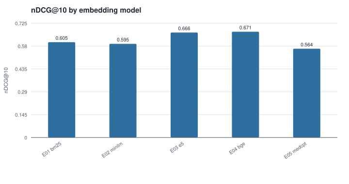

| Experiment | Model | Revision | Dim | Query-embed p95 ms | Vector-search p95 ms | Index build s (embedding) | Index bytes | Truncated documents | Queries truncated by the encoder |
|---|---|---|---|---|---|---|---|---|---|
| E01 | — | — | — | — | — | — | 188933 | — | — |
| E02 | sentence-transformers/all-MiniLM-L6-v2 | 1110a243fdf4706b3f48f1d95db1a4f5529b4d41 | 384 | 5.8358 | 0.2530 | 0.2352 | 491613 | 0 | 0 |
| E03 | intfloat/e5-base-v2 | f52bf8ec8c7124536f0efb74aca902b2995e5bcd | 768 | 31.2453 | 0.2849 | 1.3973 | 776809 | 0 | 0 |
| E04 | BAAI/bge-base-en-v1.5 | a5beb1e3e68b9ab74eb54cfd186867f64f240e1a | 768 | 27.9952 | 0.2670 | 1.2946 | 777185 | 0 | 0 |
| E05 | ncbi/MedCPT-Article-Encoder | d05a736da4bb84ee4057b7f7999485be6ed85465 | 768 | 25.5013 | 0.2562 | 1.2797 | 778313 | 0 | 0 |

The local backend performs exact kNN; approximate-kNN latency and recall must be measured on the Elasticsearch backend.

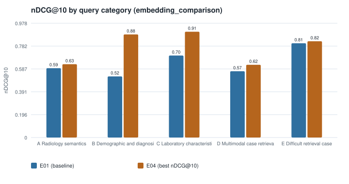

## 6. Chunking comparison

| Experiment | Embedding | Retrieval | Fusion | Reranker | Modalities | Recall@10 | Precision@10 | nDCG@10 | p95 retrieval ms | Faithfulness | Index bytes | Status |
|---|---|---|---|---|---|---|---|---|---|---|---|---|
| C01 | minilm | dense | — | — | text | 0.4068 | 0.3967 | 0.5946 | 5.5955 | — | 491613 | completed |
| C02 | minilm | dense | — | — | text | 0.4068 | 0.3967 | 0.5946 | 5.6045 | — | 490297 | completed |
| C03 | minilm | dense | — | — | text | 0.4068 | 0.3967 | 0.5946 | 5.6915 | — | 490297 | completed |
| C04 | minilm | dense | — | — | text | 0.4068 | 0.3967 | 0.5946 | 5.5535 | — | 491049 | completed |
| C05 | minilm | dense | — | — | text | 0.4068 | 0.3967 | 0.5946 | 5.6285 | — | 491049 | completed |
| C06 | minilm | dense | — | — | text | 0.4068 | 0.3967 | 0.5946 | 5.7115 | — | 490109 | completed |
| C07 | minilm | dense | — | — | text | 0.3553 | 0.3700 | 0.5487 | 5.9005 | — | 859213 | completed |

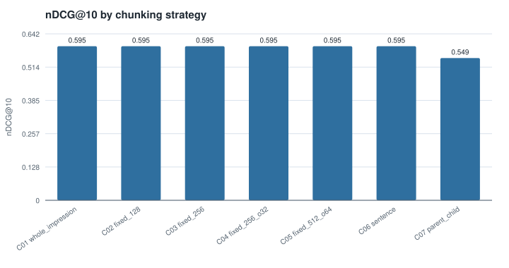

| Experiment | Chunking | Chunks | Avg tokens | Max tokens | % documents truncated | Embedding s | Index bytes | Recall@10 | nDCG@10 | p95 ms |
|---|---|---|---|---|---|---|---|---|---|---|
| C01 | whole_impression | 188 | 29.3400 | 57 | 0.0000 | 0.2352 | 491613 | 0.4068 | 0.5946 | 9.1760 |
| C02 | fixed_128 | 188 | 29.3400 | 57 | 0.0000 | 0.0012 | 490297 | 0.4068 | 0.5946 | 9.1140 |
| C03 | fixed_256 | 188 | 29.3400 | 57 | 0.0000 | 0.0008 | 490297 | 0.4068 | 0.5946 | 9.3930 |
| C04 | fixed_256_o32 | 188 | 29.3400 | 57 | 0.0000 | 0.0007 | 491049 | 0.4068 | 0.5946 | 9.0915 |
| C05 | fixed_512_o64 | 188 | 29.3400 | 57 | 0.0000 | 0.0007 | 491049 | 0.4068 | 0.5946 | 9.2205 |
| C06 | sentence | 188 | 29.3400 | 57 | 0.0000 | 0.0007 | 490109 | 0.4068 | 0.5946 | 9.4055 |
| C07 | parent_child | 336 | 16.4200 | 24 | 0.0000 | 0.1127 | 859213 | 0.3553 | 0.5487 | 9.3875 |

Short impressions are never split, so strategies whose limits exceed the impression length produce identical chunk sets and therefore identical results.

## 7. Retrieval-method comparison

| Experiment | Embedding | Retrieval | Fusion | Reranker | Modalities | Recall@10 | Precision@10 | nDCG@10 | p95 retrieval ms | Faithfulness | Index bytes | Status |
|---|---|---|---|---|---|---|---|---|---|---|---|---|
| R11 | minilm | bm25+dense | rrf | — | text | 0.4945 | 0.4267 | 0.6255 | 6.1415 | — | 680546 | completed |
| R04 | minilm | bm25+dense | weighted_score | — | text | 0.4615 | 0.4133 | 0.6102 | 6.2290 | — | 680546 | completed |
| R03 | minilm | bm25+dense | rrf | — | text | 0.4671 | 0.4100 | 0.6091 | 6.0245 | — | 680546 | completed |
| R01 | — | bm25 | — | — | text | 0.4880 | 0.4167 | 0.6049 | 1.8200 | — | 188933 | completed |
| R05 | minilm | bm25+dense | rrf | ms_marco_minilm | text | 0.4514 | 0.3933 | 0.6003 | 111.5355 | — | 680546 | completed |
| R06 | minilm | bm25+dense | rrf | medcpt_cross_encoder | text | 0.4512 | 0.4067 | 0.5995 | 571.9015 | — | 680546 | completed |
| R08 | minilm | bm25+dense | rrf | — | text+image | 0.4476 | 0.4033 | 0.5952 | 5.9055 | — | 680546 | completed |
| R02 | minilm | dense | — | — | text | 0.4068 | 0.3967 | 0.5946 | 5.6710 | — | 491613 | completed |
| R09 | minilm | bm25+dense | rrf | — | text+laboratory+image | 0.4596 | 0.4133 | 0.5852 | 6.1115 | — | 680546 | completed |
| R07 | minilm | bm25+dense | rrf | — | text+laboratory | 0.4358 | 0.3967 | 0.5790 | 6.0640 | — | 680546 | completed |
| R10 | — | — | — | — | — | — | — | — | — | — | — | skipped (query enhancement 'llm_rewrite' requires a local LLM backend (generation.backend); none is configured) |
| R12 | — | — | — | — | — | — | — | — | — | — | — | skipped (query enhancement 'hyde' requires a local LLM backend (generation.backend); none is configured) |

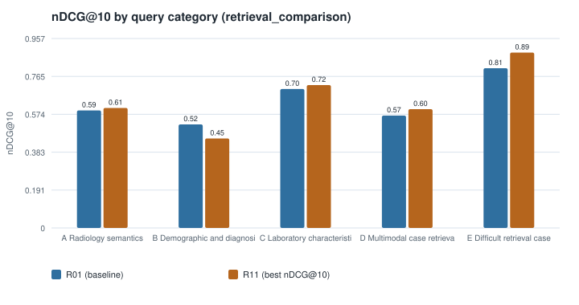

## 8. Reranking comparison

| Experiment | Embedding | Retrieval | Fusion | Reranker | Modalities | Recall@10 | Precision@10 | nDCG@10 | p95 retrieval ms | Faithfulness | Index bytes | Status |
|---|---|---|---|---|---|---|---|---|---|---|---|---|
| D04 | minilm | bm25+dense | rrf | medcpt_cross_encoder | text | 0.4522 | 0.4100 | 0.6185 | 296.6295 | — | 680546 | completed |
| D01 | minilm | bm25+dense | rrf | ms_marco_minilm | text | 0.4840 | 0.4300 | 0.6170 | 62.9355 | — | 680546 | completed |
| D00 | minilm | bm25+dense | rrf | — | text | 0.4671 | 0.4100 | 0.6091 | 5.9480 | — | 680546 | completed |
| D02 | minilm | bm25+dense | rrf | ms_marco_minilm | text | 0.4514 | 0.3933 | 0.6003 | 111.0960 | — | 680546 | completed |
| D05 | minilm | bm25+dense | rrf | medcpt_cross_encoder | text | 0.4512 | 0.4067 | 0.5995 | 573.8440 | — | 680546 | completed |
| D03 | minilm | bm25+dense | rrf | ms_marco_minilm | text | 0.4426 | 0.3900 | 0.5980 | 212.5740 | — | 680546 | completed |
| D06 | minilm | bm25+dense | rrf | medcpt_cross_encoder | text | 0.4519 | 0.4100 | 0.5939 | 1142.3915 | — | 680546 | completed |

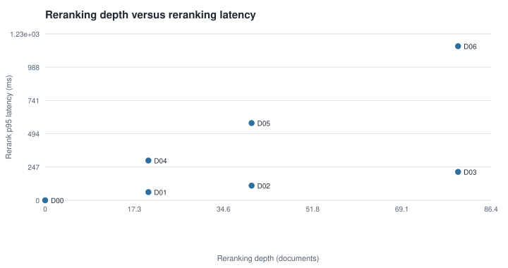

## 9. Multimodal ablation

| Experiment | Embedding | Retrieval | Fusion | Reranker | Modalities | Recall@10 | Precision@10 | nDCG@10 | p95 retrieval ms | Faithfulness | Index bytes | Status |
|---|---|---|---|---|---|---|---|---|---|---|---|---|
| M01 | hashing | bm25+dense | rrf | — | text | 0.4710 | 0.4033 | 0.5946 | 2.3040 | — | 670770 | completed |
| M05 | hashing | bm25+dense | rrf | — | text+image | 0.4912 | 0.4167 | 0.5921 | 2.5390 | — | 670770 | completed |
| M04 | hashing | bm25+dense | rrf | — | text+laboratory+diagnosis | 0.4736 | 0.4033 | 0.5763 | 2.7530 | — | 670770 | completed |
| M07 | hashing | bm25+dense | rrf | — | text+laboratory+diagnosis+image | 0.4652 | 0.4033 | 0.5713 | 2.9280 | — | 670770 | completed |
| M08 | hashing | bm25+dense | rrf | — | text+laboratory+diagnosis+image | 0.4747 | 0.4067 | 0.5712 | 3.0410 | — | 670770 | completed |
| M03 | — | structured | — | — | image | 0.2873 | 0.2682 | 0.4332 | 2.0642 | — | 0 | completed |
| M06 | — | structured | — | — | laboratory+diagnosis+image | 0.2259 | 0.2182 | 0.3326 | 2.6839 | — | 0 | completed |
| M02 | — | structured | — | — | laboratory+diagnosis | 0.1397 | 0.1182 | 0.1901 | 5.1846 | — | 0 | completed |

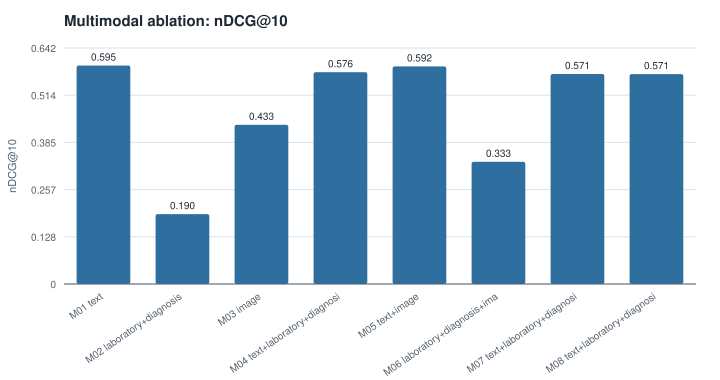

| Experiment | Modalities | Applicable queries | Coverage: laboratory | Coverage: image | nDCG@10 |
|---|---|---|---|---|---|
| M01 | text | 1.0000 | 1.0000 | 0.9174 | 0.5946 |
| M02 | laboratory+diagnosis | 0.7097 | 1.0000 | 0.9045 | 0.1901 |
| M03 | image | 0.7097 | 1.0000 | 1.0000 | 0.4332 |
| M04 | text+laboratory+diagnosis | 1.0000 | 1.0000 | 0.9241 | 0.5763 |
| M05 | text+image | 1.0000 | 1.0000 | 0.9108 | 0.5921 |
| M06 | laboratory+diagnosis+image | 0.7097 | 1.0000 | 0.8773 | 0.3326 |
| M07 | text+laboratory+diagnosis+image | 1.0000 | 1.0000 | 0.9241 | 0.5713 |
| M08 | text+laboratory+diagnosis+image | 1.0000 | 1.0000 | 0.9241 | 0.5712 |

Runs without a text retriever cannot represent free-text queries; their means cover applicable queries only (see the applicability column).

## 10. RAG generation evaluation

| Experiment | Embedding | Retrieval | Fusion | Reranker | Modalities | Recall@10 | Precision@10 | nDCG@10 | p95 retrieval ms | Faithfulness | Index bytes | Status |
|---|---|---|---|---|---|---|---|---|---|---|---|---|
| G01 | hashing | bm25+dense | rrf | — | text | 0.4710 | 0.4033 | 0.5946 | 2.3110 | 1.0000 | 670770 | completed |
| G02 | — | — | — | — | — | — | — | — | — | — | — | failed (dependency_unavailable: Ollama request failed: ConnectError) |
| G03 | — | — | — | — | — | — | — | — | — | — | — | failed (dependency_unavailable: Ollama request failed: ConnectError) |
| G04 | — | — | — | — | — | — | — | — | — | — | — | failed (dependency_unavailable: Ollama request failed: ConnectError) |
| G05 | — | — | — | — | — | — | — | — | — | — | — | failed (dependency_unavailable: Ollama request failed: ConnectError) |
| G06 | — | — | — | — | — | — | — | — | — | — | — | failed (dependency_unavailable: Ollama request failed: ConnectError) |

| Experiment | Backend / model | Prompt | Verified | Relevance | Faithfulness | Citation correctness | Citation coverage | Completeness | Abstention | Contradiction | Numeric accuracy | Latency ms | Output tokens |
|---|---|---|---|---|---|---|---|---|---|---|---|---|---|
| G01 | extractive / extractive-evidence-v1 | structured_citations | yes | 1.0000 | 1.0000 | 1.0000 | 1.0000 | 1.0000 | 1.0000 | 0.0000 | 1.0000 | 0.2977 | 690.5556 |

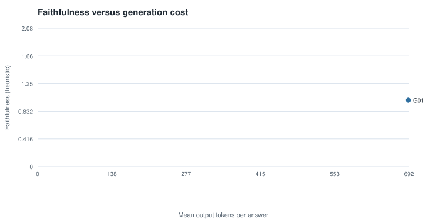

## Main comparison table (all completed and attempted experiments)

| Experiment | Embedding | Retrieval | Fusion | Reranker | Modalities | Recall@10 | Precision@10 | nDCG@10 | p95 retrieval ms | Faithfulness | Index bytes | Status |
|---|---|---|---|---|---|---|---|---|---|---|---|---|
| C01 | minilm | dense | — | — | text | 0.4068 | 0.3967 | 0.5946 | 5.5955 | — | 491613 | completed |
| C02 | minilm | dense | — | — | text | 0.4068 | 0.3967 | 0.5946 | 5.6045 | — | 490297 | completed |
| C03 | minilm | dense | — | — | text | 0.4068 | 0.3967 | 0.5946 | 5.6915 | — | 490297 | completed |
| C04 | minilm | dense | — | — | text | 0.4068 | 0.3967 | 0.5946 | 5.5535 | — | 491049 | completed |
| C05 | minilm | dense | — | — | text | 0.4068 | 0.3967 | 0.5946 | 5.6285 | — | 491049 | completed |
| C06 | minilm | dense | — | — | text | 0.4068 | 0.3967 | 0.5946 | 5.7115 | — | 490109 | completed |
| C07 | minilm | dense | — | — | text | 0.3553 | 0.3700 | 0.5487 | 5.9005 | — | 859213 | completed |
| E04 | bge | dense | — | — | text | 0.5015 | 0.4433 | 0.6714 | 28.6605 | — | 777185 | completed |
| E03 | e5 | dense | — | — | text | 0.4911 | 0.4600 | 0.6660 | 31.9955 | — | 776809 | completed |
| E01 | — | bm25 | — | — | text | 0.4880 | 0.4167 | 0.6049 | 1.8745 | — | 188933 | completed |
| E02 | minilm | dense | — | — | text | 0.4068 | 0.3967 | 0.5946 | 6.5120 | — | 491613 | completed |
| E05 | medcpt | dense | — | — | text | 0.4017 | 0.3567 | 0.5635 | 26.2040 | — | 778313 | completed |
| R01 | — | bm25 | — | — | text | 0.4706 | 0.3407 | 0.5578 | 1.8892 | — | 188933 | completed |
| G01 | hashing | bm25+dense | rrf | — | text | 0.4710 | 0.4033 | 0.5946 | 2.3110 | 1.0000 | 670770 | completed |
| G02 | — | — | — | — | — | — | — | — | — | — | — | failed (dependency_unavailable: Ollama request failed: ConnectError) |
| G03 | — | — | — | — | — | — | — | — | — | — | — | failed (dependency_unavailable: Ollama request failed: ConnectError) |
| G04 | — | — | — | — | — | — | — | — | — | — | — | failed (dependency_unavailable: Ollama request failed: ConnectError) |
| G05 | — | — | — | — | — | — | — | — | — | — | — | failed (dependency_unavailable: Ollama request failed: ConnectError) |
| G06 | — | — | — | — | — | — | — | — | — | — | — | failed (dependency_unavailable: Ollama request failed: ConnectError) |
| M01 | hashing | bm25+dense | rrf | — | text | 0.4710 | 0.4033 | 0.5946 | 2.3040 | — | 670770 | completed |
| M05 | hashing | bm25+dense | rrf | — | text+image | 0.4912 | 0.4167 | 0.5921 | 2.5390 | — | 670770 | completed |
| M04 | hashing | bm25+dense | rrf | — | text+laboratory+diagnosis | 0.4736 | 0.4033 | 0.5763 | 2.7530 | — | 670770 | completed |
| M07 | hashing | bm25+dense | rrf | — | text+laboratory+diagnosis+image | 0.4652 | 0.4033 | 0.5713 | 2.9280 | — | 670770 | completed |
| M08 | hashing | bm25+dense | rrf | — | text+laboratory+diagnosis+image | 0.4747 | 0.4067 | 0.5712 | 3.0410 | — | 670770 | completed |
| M03 | — | structured | — | — | image | 0.2873 | 0.2682 | 0.4332 | 2.0642 | — | 0 | completed |
| M06 | — | structured | — | — | laboratory+diagnosis+image | 0.2259 | 0.2182 | 0.3326 | 2.6839 | — | 0 | completed |
| M02 | — | structured | — | — | laboratory+diagnosis | 0.1397 | 0.1182 | 0.1901 | 5.1846 | — | 0 | completed |
| D04 | minilm | bm25+dense | rrf | medcpt_cross_encoder | text | 0.4522 | 0.4100 | 0.6185 | 296.6295 | — | 680546 | completed |
| D01 | minilm | bm25+dense | rrf | ms_marco_minilm | text | 0.4840 | 0.4300 | 0.6170 | 62.9355 | — | 680546 | completed |
| D00 | minilm | bm25+dense | rrf | — | text | 0.4671 | 0.4100 | 0.6091 | 5.9480 | — | 680546 | completed |
| D02 | minilm | bm25+dense | rrf | ms_marco_minilm | text | 0.4514 | 0.3933 | 0.6003 | 111.0960 | — | 680546 | completed |
| D05 | minilm | bm25+dense | rrf | medcpt_cross_encoder | text | 0.4512 | 0.4067 | 0.5995 | 573.8440 | — | 680546 | completed |
| D03 | minilm | bm25+dense | rrf | ms_marco_minilm | text | 0.4426 | 0.3900 | 0.5980 | 212.5740 | — | 680546 | completed |
| D06 | minilm | bm25+dense | rrf | medcpt_cross_encoder | text | 0.4519 | 0.4100 | 0.5939 | 1142.3915 | — | 680546 | completed |
| R11 | minilm | bm25+dense | rrf | — | text | 0.4945 | 0.4267 | 0.6255 | 6.1415 | — | 680546 | completed |
| R04 | minilm | bm25+dense | weighted_score | — | text | 0.4615 | 0.4133 | 0.6102 | 6.2290 | — | 680546 | completed |
| R03 | minilm | bm25+dense | rrf | — | text | 0.4671 | 0.4100 | 0.6091 | 6.0245 | — | 680546 | completed |
| R01 | — | bm25 | — | — | text | 0.4880 | 0.4167 | 0.6049 | 1.8200 | — | 188933 | completed |
| R05 | minilm | bm25+dense | rrf | ms_marco_minilm | text | 0.4514 | 0.3933 | 0.6003 | 111.5355 | — | 680546 | completed |
| R06 | minilm | bm25+dense | rrf | medcpt_cross_encoder | text | 0.4512 | 0.4067 | 0.5995 | 571.9015 | — | 680546 | completed |
| R08 | minilm | bm25+dense | rrf | — | text+image | 0.4476 | 0.4033 | 0.5952 | 5.9055 | — | 680546 | completed |
| R02 | minilm | dense | — | — | text | 0.4068 | 0.3967 | 0.5946 | 5.6710 | — | 491613 | completed |
| R09 | minilm | bm25+dense | rrf | — | text+laboratory+image | 0.4596 | 0.4133 | 0.5852 | 6.1115 | — | 680546 | completed |
| R07 | minilm | bm25+dense | rrf | — | text+laboratory | 0.4358 | 0.3967 | 0.5790 | 6.0640 | — | 680546 | completed |
| R10 | — | — | — | — | — | — | — | — | — | — | — | skipped (query enhancement 'llm_rewrite' requires a local LLM backend (generation.backend); none is configured) |
| R12 | — | — | — | — | — | — | — | — | — | — | — | skipped (query enhancement 'hyde' requires a local LLM backend (generation.backend); none is configured) |
| S05 | hashing | bm25+dense | rrf | lexical_overlap | text | 0.4732 | 0.4233 | 0.6308 | 2.5410 | — | 670770 | completed |
| S02 | hashing | dense | — | — | text | 0.4632 | 0.4200 | 0.6132 | 1.2755 | — | 481837 | completed |
| S01 | — | bm25 | — | — | text | 0.4880 | 0.4167 | 0.6049 | 1.7830 | — | 188933 | completed |
| S03 | hashing | bm25+dense | rrf | — | text | 0.4710 | 0.4033 | 0.5946 | 2.1555 | 1.0000 | 670770 | completed |
| S04 | hashing | bm25+dense | weighted_score | — | text | 0.4672 | 0.4067 | 0.5891 | 2.2335 | — | 670770 | completed |
| S06 | hashing | bm25+dense | rrf | — | text+laboratory+image+diagnosis | 0.4652 | 0.4033 | 0.5713 | 3.6715 | — | 670770 | completed |

## 11. Latency and resource evaluation

| Experiment | p50 ms | p90 ms | p95 ms | rerank p95 ms | query-embed p95 ms | Index bytes | Peak RSS MB | Peak GPU MB |
|---|---|---|---|---|---|---|---|---|
| C01 | 4.7340 | 9.0510 | 9.1760 | 0.0010 | 4.9553 | 491613 | 2516.2000 | — |
| C02 | 4.5890 | 9.0420 | 9.1140 | 0.0010 | 4.9387 | 490297 | 2516.2000 | — |
| C03 | 4.5390 | 9.3540 | 9.3930 | 0.0010 | 5.0180 | 490297 | 2516.2000 | — |
| C04 | 4.7280 | 9.0390 | 9.0915 | 0.0010 | 4.8936 | 491049 | 2516.2000 | — |
| C05 | 4.5730 | 9.1100 | 9.2205 | 0.0015 | 4.9505 | 491049 | 2516.2000 | — |
| C06 | 4.6490 | 9.1270 | 9.4055 | 0.0020 | 5.0300 | 490109 | 2516.2000 | — |
| C07 | 4.6790 | 9.3260 | 9.3875 | 0.0010 | 5.1198 | 859213 | 2516.2000 | — |
| E01 | 4.5410 | 5.3960 | 5.4215 | 0.0010 | — | 188933 | 271.5000 | — |
| E02 | 4.6680 | 9.9390 | 10.1630 | 0.0020 | 5.8358 | 491613 | 746.7000 | — |
| E03 | 4.9020 | 34.9140 | 35.7945 | 0.0020 | 31.2453 | 776809 | 1520.3000 | — |
| E04 | 4.9020 | 30.6210 | 32.0220 | 0.0020 | 27.9952 | 777185 | 1917.7000 | — |
| E05 | 4.7760 | 29.7030 | 29.9235 | 0.0020 | 25.5013 | 778313 | 2516.2000 | — |
| R01 | 4.7785 | 5.3672 | 5.4884 | 0.0010 | — | 188933 | 259.6000 | — |
| G01 | 5.3630 | 5.7860 | 5.8180 | 0.0010 | 0.0811 | 670770 | 3153.5000 | — |
| M01 | 4.8960 | 5.6170 | 5.7110 | 0.0010 | 0.0646 | 670770 | 267.7000 | — |
| M02 | 5.0735 | 11.0462 | 14.8557 | — | — | 0 | 269.0000 | — |
| M03 | 4.5810 | 5.2880 | 6.1575 | — | — | 0 | 269.2000 | — |
| M04 | 5.4520 | 6.0780 | 6.1965 | 0.0010 | 0.0647 | 670770 | 269.3000 | — |
| M05 | 5.5640 | 5.8500 | 6.1555 | 0.0010 | 0.0740 | 670770 | 269.4000 | — |
| M06 | 5.5980 | 5.8735 | 5.9845 | — | — | 0 | 269.5000 | — |
| M07 | 5.8730 | 6.2770 | 6.3115 | 0.0010 | 0.0632 | 670770 | 269.5000 | — |
| M08 | 5.8570 | 6.4370 | 6.5950 | 0.0010 | 0.0642 | 670770 | 269.5000 | — |
| D00 | 5.6350 | 9.4150 | 9.7520 | 0.0010 | 4.8540 | 680546 | 3153.5000 | — |
| D01 | 50.5360 | 59.6760 | 66.4520 | 60.6902 | 5.1122 | 680546 | 3153.5000 | — |
| D02 | 84.3600 | 111.2160 | 124.1115 | 108.8782 | 4.9065 | 680546 | 3153.5000 | — |
| D03 | 156.9200 | 199.7320 | 216.7075 | 210.6283 | 5.0861 | 680546 | 3153.5000 | — |
| D04 | 218.0260 | 285.3690 | 299.7305 | 295.0358 | 5.3178 | 680546 | 3153.5000 | — |
| D05 | 423.5090 | 552.1090 | 578.0655 | 572.9848 | 5.6021 | 680546 | 3153.5000 | — |
| D06 | 865.8280 | 1108.9260 | 1158.6845 | 1143.4042 | 5.4881 | 680546 | 3153.5000 | — |
| R01 | 4.7780 | 5.1310 | 5.2710 | 0.0010 | — | 188933 | 2516.2000 | — |
| R02 | 4.5920 | 9.0550 | 9.3490 | 0.0010 | 5.0522 | 491613 | 2516.2000 | — |
| R03 | 5.6970 | 9.5400 | 9.8190 | 0.0010 | 4.9791 | 680546 | 2516.2000 | — |
| R04 | 5.6400 | 9.7570 | 9.8495 | 0.0015 | 5.0738 | 680546 | 2516.2000 | — |
| R05 | 92.5840 | 109.5150 | 115.6940 | 109.3550 | 6.6132 | 680546 | 2516.2000 | — |
| R06 | 425.6960 | 559.7700 | 576.0110 | 570.8924 | 5.5720 | 680546 | 3153.5000 | — |
| R07 | 6.1760 | 9.5270 | 9.8290 | 0.0020 | 5.0354 | 680546 | 3153.5000 | — |
| R08 | 6.1530 | 9.4250 | 9.5775 | 0.0015 | 4.8561 | 680546 | 3153.5000 | — |
| R09 | 6.3980 | 9.7300 | 10.0480 | 0.0010 | 4.9846 | 680546 | 3153.5000 | — |
| R11 | 5.6940 | 9.5740 | 9.6625 | 0.0010 | 4.9918 | 680546 | 3153.5000 | — |
| S01 | 4.5470 | 5.2150 | 5.2395 | 0.0010 | — | 188933 | 248.7000 | — |
| S02 | 4.1810 | 4.6790 | 4.7795 | 0.0010 | 0.0671 | 481837 | 249.3000 | — |
| S03 | 4.8570 | 5.4710 | 5.6200 | 0.0010 | 0.0687 | 670770 | 249.6000 | — |
| S04 | 4.8080 | 5.6810 | 5.7060 | 0.0010 | 0.0626 | 670770 | 249.9000 | — |
| S05 | 5.0760 | 5.6740 | 5.8780 | 0.3371 | 0.0712 | 670770 | 249.9000 | — |
| S06 | 5.9580 | 6.9520 | 7.0155 | 0.0010 | 0.0677 | 670770 | 251.4000 | — |

Measured on: cpu_count=12, cuda_available=False, machine=arm64, platform=macOS-15.5-arm64-arm-64bit, processor=arm, python=3.11.1, torch=2.15.0. Latencies are single-process, concurrency 1, after warm-up queries; they are only comparable between runs on the same hardware.

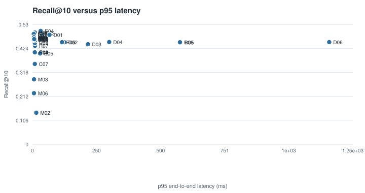

## 12. Statistical uncertainty

Paired bootstrap over evaluation queries (same queries for both systems), 95% interval for the difference in nDCG@10 versus each suite's baseline.

| Suite | Comparison | Queries | Δ nDCG@10 | CI low | CI high | Wins/Losses/Ties | Gain share of top 10% queries | CI excludes 0 (improvement) |
|---|---|---|---|---|---|---|---|---|
| chunking_comparison | C02 vs C01 | 30 | 0.0000 | 0.0000 | 0.0000 | 0/0/30 | — | no |
| chunking_comparison | C03 vs C01 | 30 | 0.0000 | 0.0000 | 0.0000 | 0/0/30 | — | no |
| chunking_comparison | C04 vs C01 | 30 | 0.0000 | 0.0000 | 0.0000 | 0/0/30 | — | no |
| chunking_comparison | C05 vs C01 | 30 | 0.0000 | 0.0000 | 0.0000 | 0/0/30 | — | no |
| chunking_comparison | C06 vs C01 | 30 | 0.0000 | 0.0000 | 0.0000 | 0/0/30 | — | no |
| chunking_comparison | C07 vs C01 | 30 | -0.0458 | -0.0862 | -0.0098 | 12/15/3 | 0.5609 | no |
| embedding_comparison | E02 vs E01 | 30 | -0.0103 | -0.0692 | 0.0500 | 13/14/3 | 0.5307 | no |
| embedding_comparison | E03 vs E01 | 30 | 0.0611 | -0.0005 | 0.1257 | 15/14/1 | 0.4210 | no |
| embedding_comparison | E04 vs E01 | 30 | 0.0665 | 0.0150 | 0.1239 | 20/8/2 | 0.4505 | yes |
| embedding_comparison | E05 vs E01 | 30 | -0.0414 | -0.1016 | 0.0144 | 15/12/3 | 0.5024 | no |
| multimodal_ablation | M02 vs M01 | 22 | -0.3994 | -0.4924 | -0.3005 | 0/22/0 | — | no |
| multimodal_ablation | M03 vs M01 | 22 | -0.1563 | -0.3314 | 0.0172 | 7/15/0 | 0.5191 | no |
| multimodal_ablation | M04 vs M01 | 30 | -0.0183 | -0.0529 | 0.0127 | 11/11/8 | 0.5541 | no |
| multimodal_ablation | M05 vs M01 | 30 | -0.0025 | -0.0390 | 0.0332 | 10/10/10 | 0.5833 | no |
| multimodal_ablation | M06 vs M01 | 22 | -0.2569 | -0.3862 | -0.1261 | 5/17/0 | 0.8506 | no |
| multimodal_ablation | M07 vs M01 | 30 | -0.0233 | -0.0680 | 0.0198 | 12/10/8 | 0.5042 | no |
| multimodal_ablation | M08 vs M01 | 30 | -0.0234 | -0.0631 | 0.0164 | 9/13/8 | 0.8156 | no |
| reranking_depth | D01 vs D00 | 30 | 0.0079 | -0.0462 | 0.0598 | 19/11/0 | 0.3700 | no |
| reranking_depth | D02 vs D00 | 30 | -0.0087 | -0.0751 | 0.0556 | 18/12/0 | 0.3973 | no |
| reranking_depth | D03 vs D00 | 30 | -0.0111 | -0.0770 | 0.0533 | 17/13/0 | 0.4165 | no |
| reranking_depth | D04 vs D00 | 30 | 0.0094 | -0.0343 | 0.0567 | 15/14/1 | 0.4683 | no |
| reranking_depth | D05 vs D00 | 30 | -0.0096 | -0.0649 | 0.0504 | 13/17/0 | 0.4924 | no |
| reranking_depth | D06 vs D00 | 30 | -0.0152 | -0.0724 | 0.0464 | 13/17/0 | 0.5518 | no |
| retrieval_comparison | R02 vs R01 | 30 | -0.0103 | -0.0692 | 0.0500 | 13/14/3 | 0.5307 | no |
| retrieval_comparison | R03 vs R01 | 30 | 0.0042 | -0.0260 | 0.0339 | 15/11/4 | 0.5086 | no |
| retrieval_comparison | R04 vs R01 | 30 | 0.0053 | -0.0268 | 0.0416 | 14/13/3 | 0.5535 | no |
| retrieval_comparison | R05 vs R01 | 30 | -0.0045 | -0.0809 | 0.0764 | 14/16/0 | 0.4685 | no |
| retrieval_comparison | R06 vs R01 | 30 | -0.0054 | -0.0689 | 0.0612 | 14/15/1 | 0.5650 | no |
| retrieval_comparison | R07 vs R01 | 30 | -0.0259 | -0.0673 | 0.0147 | 17/13/0 | 0.4121 | no |
| retrieval_comparison | R08 vs R01 | 30 | -0.0097 | -0.0531 | 0.0342 | 16/12/2 | 0.4589 | no |
| retrieval_comparison | R09 vs R01 | 30 | -0.0197 | -0.0684 | 0.0289 | 17/13/0 | 0.3948 | no |
| retrieval_comparison | R11 vs R01 | 30 | 0.0206 | -0.0224 | 0.0599 | 16/10/4 | 0.5019 | no |
| smoke | S02 vs S01 | 30 | 0.0083 | -0.0208 | 0.0394 | 16/9/5 | 0.4540 | no |
| smoke | S03 vs S01 | 30 | -0.0103 | -0.0278 | 0.0056 | 11/14/5 | 0.6274 | no |
| smoke | S04 vs S01 | 30 | -0.0158 | -0.0390 | 0.0084 | 12/12/6 | 0.6725 | no |
| smoke | S05 vs S01 | 30 | 0.0259 | -0.0200 | 0.0707 | 14/10/6 | 0.4460 | no |
| smoke | S06 vs S01 | 30 | -0.0336 | -0.0786 | 0.0126 | 15/15/0 | 0.4358 | no |

Relevance judgments are incomplete (see judged coverage); intervals reflect query sampling variability only, not annotation uncertainty.

## 13. Error analysis

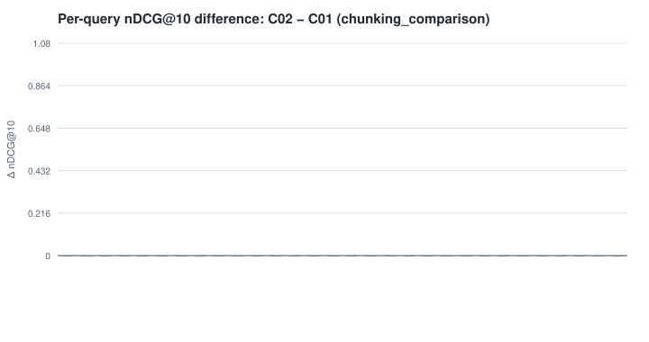

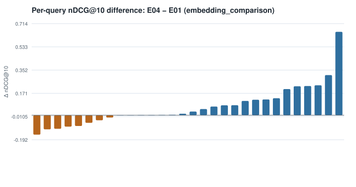

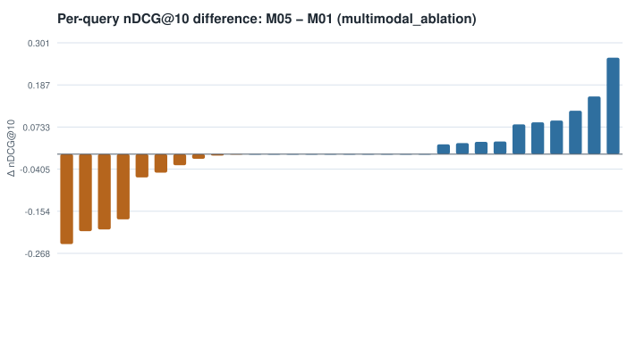

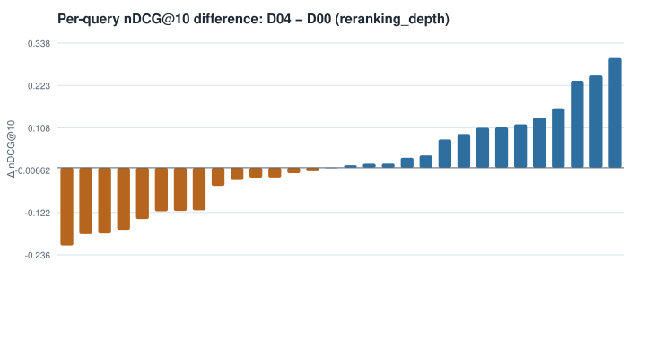

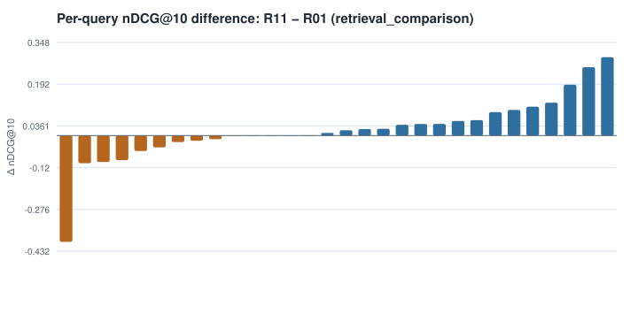

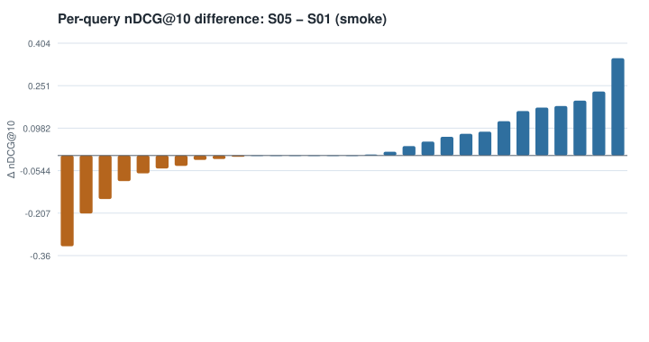
| Suite | Run | Failure category (heuristic) | Queries |
|---|---|---|---|
| chunking_comparison | C02 | embedding_model_failure | 2 |
| multimodal_ablation | M05 | semantic_mismatch | 1 |
| multimodal_ablation | M05 | image_representation_mismatch | 2 |
| reranking_depth | D04 | semantic_mismatch | 2 |
| retrieval_comparison | R11 | semantic_mismatch | 1 |
| smoke | S05 | reranker_degradation | 2 |

Categories are automatic triage labels for manual review. Per-query lists of cases retrieved by one method and missed by the other are in `report.json` (identifiers only).

## 14. Selected final architecture

Selected on validation data: **R01** (baseline `R01`, suite `retrieval_comparison`).

Rationale: no configuration showed a credible improvement; simpler baseline kept.

| Experiment | Decision | Reason | nDCG@10 |
|---|---|---|---|
| R01 | baseline | — | 0.6049 |
| R02 | not_selected | no credible improvement over the baseline (95% CI includes 0) | 0.5946 |
| R03 | not_selected | no credible improvement over the baseline (95% CI includes 0) | 0.6091 |
| R04 | not_selected | no credible improvement over the baseline (95% CI includes 0) | 0.6102 |
| R05 | not_selected | no credible improvement over the baseline (95% CI includes 0) | 0.6003 |
| R06 | not_selected | no credible improvement over the baseline (95% CI includes 0) | 0.5995 |
| R07 | not_selected | no credible improvement over the baseline (95% CI includes 0) | 0.5790 |
| R08 | not_selected | no credible improvement over the baseline (95% CI includes 0) | 0.5952 |
| R09 | not_selected | no credible improvement over the baseline (95% CI includes 0) | 0.5852 |
| R11 | not_selected | no credible improvement over the baseline (95% CI includes 0) | 0.6255 |

Held-out test evaluation of the frozen configuration (run once):

| Experiment | Embedding | Retrieval | Fusion | Reranker | Modalities | Recall@10 | Precision@10 | nDCG@10 | p95 retrieval ms | Faithfulness | Index bytes | Status |
|---|---|---|---|---|---|---|---|---|---|---|---|---|
| R01 | — | bm25 | — | — | text | 0.4706 | 0.3407 | 0.5578 | 1.8892 | — | 188933 | completed |

## 15. Limitations and future work

- All results in this report are from synthetic fixtures; no INSPECT experiment has been run. The INSPECT adapters are not yet validated against the real release.
- INSPECT is a research dataset; this system is not validated for clinical care.
- INSPECT labels (PE status, outcomes) do not define clinical similarity; conclusions depend on the separate, incomplete relevance annotations.
- Dates are patient-specifically shifted: only within-patient temporal order is meaningful.
- Image similarity uses an experimental representation and is not a validated lesion comparison.
- Automated generation metrics are heuristics that require calibration against human review.
